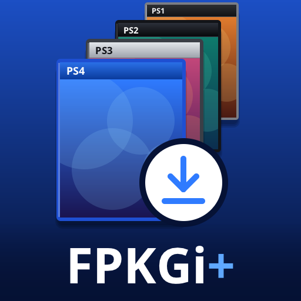
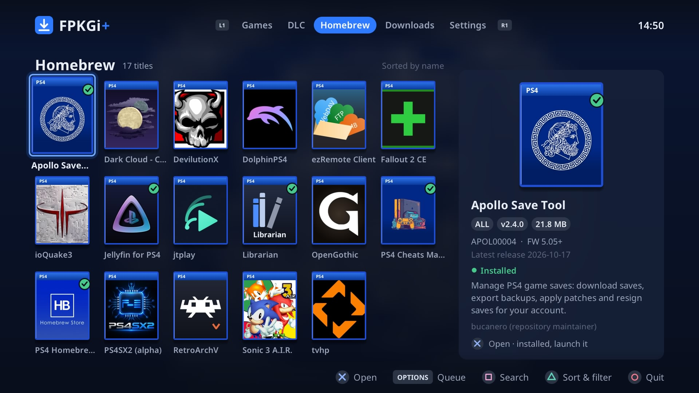
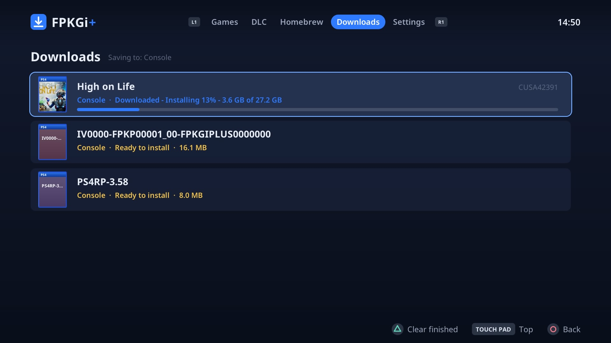
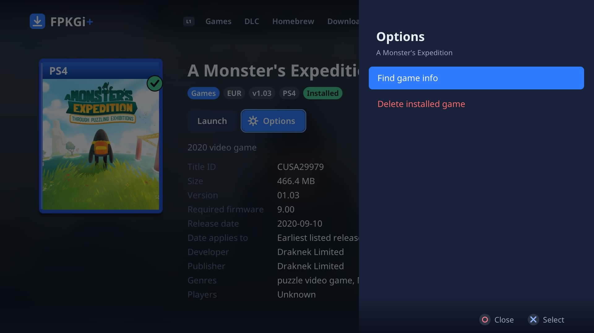
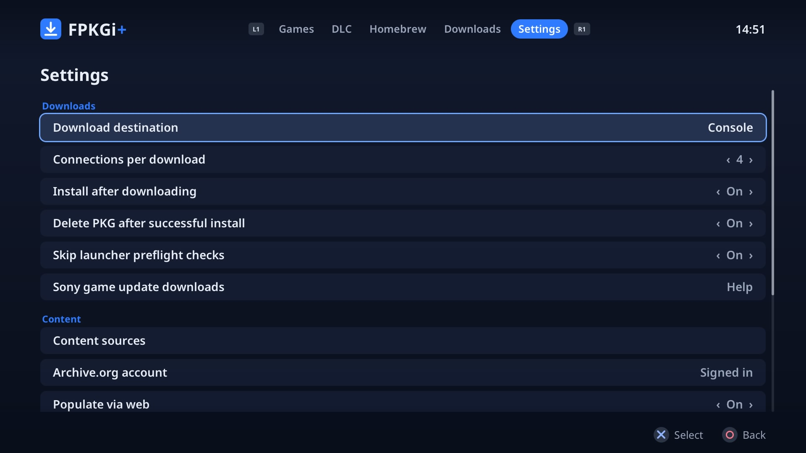
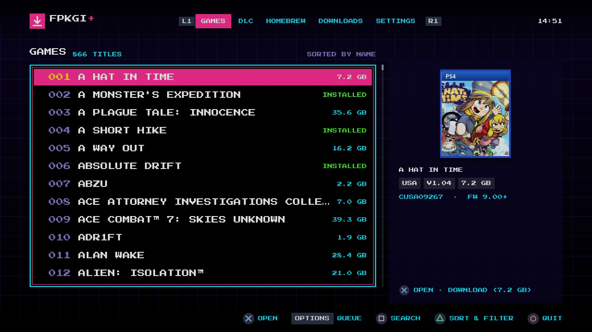

<div align="center">
  

  A package browser, downloader and installer for the PlayStation 4: your content lists, with covers, details and a download queue.

  <p>
    
    
    
    <a href="LICENSE"></a>
  </p>

  <a href="docs/DETAILS.md">How it works</a> ·
  <a href="NOTICE">Licence and credits</a> ·
  <a href="#building-from-source">Building from source</a>
</div>

<br>

FPKGi+ is a standalone package browser, downloader and installer for jailbroken PS4 consoles. Point it at your own content lists, browse them with cover art and game details, download PKGs to the console or a USB drive, and install, launch, update or delete titles without leaving the app. It reads the same `DATA` JSON content-list format as FPKGi, and is inspired by [PKGi](https://github.com/bucanero/pkgi-ps3) by bucanero.

> [!IMPORTANT]
> **FPKGi+ does not include any games or PKGs.** The only list it ships with is a Homebrew list of open-source PS4 homebrew downloaded from the projects' own GitHub releases. Everything else it shows comes from content lists that you add yourself, and you are responsible for having the right to download and install whatever those lists point to.

## Features

- **Catalogue tabs:** Games, Updates, DLC, Apps, Homebrew, Emulators, Themes, Demos, PS1, PS2 and PSP. A tab only appears when its content list has entries. PS1, PS2 and PSP titles are shown in their own platform's case.
- **Built-in Homebrew list:** 17 open-source apps, games and emulators (Apollo Save Tool, RetroArch, DolphinPS4, Librarian and more), ready to download and keep updated. Tabs show cover art, region, version, size and required firmware, and installed titles get a tick.
- **Downloads:** resumable downloads with up to 8 connections each. Choose the console or a USB drive as the destination. The queue survives closing the app, and the free space is checked before each download starts.
- **Background downloads:** downloads keep going after FPKGi+ is closed and while you play other games; in rest mode they pause and continue when the console wakes. A notification appears when a download finishes or fails, wherever you are on the console. See [Background downloads](#background-downloads).
- **Install and manage:** optionally install automatically after downloading and delete the PKG once the install is verified. You can also launch installed titles, delete installed games or apps, and delete downloaded PKGs.
- **Game details:** descriptions, developer, publisher, genres, players and release dates, looked up automatically from [Wikidata](https://www.wikidata.org/) and cached for offline use.
- **Homebrew updates:** installed homebrew linked to a GitHub release can be checked against the latest release. An update is only offered when the published PKG has the same title ID and a newer version.
- **Archive.org sign-in:** download files that need an Archive.org account. Your password is never saved.
- **Two themes:** Modern and Retro arcade.

| Homebrew | Downloads |
| --- | --- |
|  |  |
| **Title options** | **Settings** |
|  |  |



## Requirements

- A jailbroken PS4 running GoldHEN. GoldHEN 2.3 or later is needed for USB drives; on HEN setups without GoldHEN's SDK, FPKGi+ falls back to a bundled credential helper adapted from [Itemzflow](https://github.com/LightningMods/Itemzflow).
- A network connection for web content lists, downloads, cover art and game details.

## Installing

1. Download `IV0000-FPKP00001_00-FPKGIPLUS0000000.pkg` from the [Releases](../../releases) page.
2. Copy it to a USB drive or send it to the console, and install it with GoldHEN's Package Installer (or any PKG installer you already use).
3. Start **FPKGi+** from the home screen.

## Updating FPKGi+

FPKGi+ checks this repository's [latest release](../../releases/latest) shortly after it starts, and shows a message when a newer version is out. In **Settings > Software update**:

1. Choose **Download**. The update is saved to `/data/pkg/FPKGiPlus-update.pkg`, and its size and SHA-256 checksum are checked against the release.
2. Close FPKGi+.
3. Install the update from **Debug Settings > Game > Package Installer**.

FPKGi+ never installs its own update while it is running, and its Install buttons refuse an FPKGi+ package.

## Background downloads

From version 1.01, downloads run in a small background service, the **FPKGi+ background downloader** (title ID `FPKP00002`), instead of inside the app. FPKGi+ installs and starts it when it opens, the way Itemzflow installs its daemon: it is copied to the console's system partition at `/system/vsh/app/FPKP00002`, and replaced when an FPKGi+ update carries a newer one.

- Downloads continue after FPKGi+ is closed and while a game or another app is running.
- In rest mode the console suspends every app and background service, the background downloader included, so a download pauses there. It continues by itself when the console wakes; if the network is not back yet, it is tried again a few times.
- A notification appears when a download finishes or fails. While the console is in rest mode, and for a minute after it wakes, notifications wait and are shown afterwards.
- Finished downloads are installed by FPKGi+: straight away if it is open and **Install after downloading** is on, otherwise the next time it opens. They are already in `/data/pkg/`, so you can also install them from GoldHEN's Package Installer.
- The background downloader needs FPKGi+ to leave its sandbox (GoldHEN). When that is not possible, or if it cannot be installed or started, FPKGi+ downloads inside the app as in version 1.00.
- **Settings > System > Background downloads** turns it off (from the next time FPKGi+ opens), and **Background downloader > Remove** stops it and deletes it from the system partition.

## Adding content

Out of the box, only the Homebrew tab has entries, from the built-in list. Every other tab stays empty until you add a content list. Adding your own `HOMEBREW.json` or Homebrew URL replaces the built-in list. There are two ways to add lists:

- **From the web:** go to **Settings > Content sources**, pick a category and enter the URL of its JSON list. Setting a URL turns on **Populate via web**. The last downloaded copy is kept for offline use.
- **Local files:** put JSON files in `/data/FPKGiPlus/ContentJSONs/` on the console (over FTP, for example), named `GAMES.json`, `DLC.json`, `UPDATES.json`, `HOMEBREW.json`, `APPS.json`, `DEMOS.json`, `EMULATORS.json`, `THEMES.json`, `PS1.json`, `PS2.json` or `PSP.json`. FPKGi's `PS5.json` is ignored, because a PS4 cannot install PS5 packages. Then choose **Settings > Reload content lists**.

On first launch, FPKGi+ copies any existing lists from FPKGi's folder (`/data/FPKGi/ContentJSONs` or `/user/data/FPKGi/ContentJSONs`) once. After that it keeps its own copies.

### Content-list format

Each key in `DATA` is the PKG's download URL:

```json
{
  "DATA": {
    "https://example.com/files/MyHomebrew.pkg": {
      "title_id": "ABCD12345",
      "name": "My Homebrew",
      "size": 12345678,
      "region": "USA",
      "version": "01.00",
      "min_fw": "5.05",
      "release": "2026-01-01",
      "cover_url": "https://example.com/covers/ABCD12345.png"
    }
  }
}
```

`title_id`, `name` and `size` are required; entries without them are skipped. These optional fields are also read: `description`, `developer`, `publisher`, `genres`, `players`, `languages`, `rating`, `release_date` (`YYYY-MM-DD`, `YYYY-MM` or `YYYY`) and, for homebrew, `homebrew_category` (`Utilities`, `Media`, `Emulators` or `Games`).

For homebrew, a GitHub release URL (`https://github.com/<owner>/<repo>/releases/latest/download/<file>.pkg` or `.../releases/download/<tag>/<file>.pkg`) enables the latest-release date and **Check for updates**.

You can also add or correct details without editing the list by creating `/data/FPKGiPlus/metadata.json`, keyed by title ID:

```json
{
  "CUSA00000": {
    "description": "A description of the game.",
    "release_date": "2020-05-04",
    "developer": "Developer name",
    "publisher": "Publisher name",
    "genres": ["Adventure", "Puzzle"],
    "players": "1 player",
    "languages": ["English"],
    "rating": "PEGI 12"
  }
}
```

## Controls

| Where | Button | Action |
| --- | --- | --- |
| Everywhere | L1 / R1 | Previous / next tab |
| Catalogue | Cross | Open the title |
| | Options | Add to the download queue |
| | Square | Search |
| | Triangle | Sort and filter (Homebrew: choose a category) |
| | Circle | Quit |
| Title details | Options, or the gear button | Title options: find game info, delete the installed title, delete the downloaded PKG |
| | Up / Down | Scroll the details |
| Downloads | Cross | Pause or resume the selected download; install a finished one |
| | Square | Stop (the partial file is kept), or delete the file |
| | Triangle | Clear finished entries (their PKGs are kept) |
| | Touch pad | Back to the top |

## Settings

| Setting | What it does |
| --- | --- |
| Download destination | **Console** (`/data/pkg/`) or **USB drive** (the drive's root). If several drives are connected, you choose one. |
| Connections per download | 1–8 parallel connections (default 4). |
| Install after downloading | Starts the install once a download finishes (off by default). |
| Delete PKG after successful install | Deletes the PKG only after the console confirms the installed version (off by default). |
| Skip launcher preflight checks | Skips the launch and system-update checks when FPKGi+ launches a title (on by default). This does not stop Sony's own background update downloads; see **Sony game update downloads** in Settings for how to turn those off. |
| Content sources | The content-list URL for each category. Leave a URL empty to use local files. |
| Archive.org account | Sign in for downloads that need an account. Your password is not saved. |
| Populate via web | Use the web URLs instead of local files. |
| Reload content lists | Reloads all lists. |
| Theme | Modern or Retro arcade. |
| Background downloads | Runs downloads in the background downloader, so they continue after FPKGi+ is closed (on by default). Takes effect the next time FPKGi+ opens. |
| Background downloader | Shows whether it is running; **Restart** or **Remove** it. |
| Debug logging | Writes more detail to the log file (off by default). |
| Software update | Checks for a newer FPKGi+ and downloads it. See [Updating FPKGi+](#updating-fpkgi). |

## Files on the console

Everything is kept in `/data/FPKGiPlus/`:

| Path | Contents |
| --- | --- |
| `config.json` | Settings and content-source URLs |
| `ContentJSONs/` | Local and cached content lists |
| `metadata.json` | Your own title details (optional) |
| `wikidata-metadata.json` | Cached game details |
| `download-queue.json` | The saved download queue |
| `service/` | The background downloader's progress and the app's requests to it |
| `service.log`, `service.prev.log` | The background downloader's logs |
| `fpkgi-plus.log`, `fpkgi-plus.prev.log` | Logs from this run and the previous one |
| `crash.log` | Written if the app crashes |

If you report a problem, please attach `fpkgi-plus.log` and `service.log` (and `crash.log` if there is one). Logs never contain passwords, cookies or email addresses.

## Building from source

You need Linux or WSL with `clang-18`, `lld-18`, `python3`, `openssl` and the [OpenOrbis PS4 toolchain](https://github.com/OpenOrbis/OpenOrbis-PS4-Toolchain). Put the toolchain in `tools/toolchain/OpenOrbis/PS4Toolchain`, or pass its location with `make TOOLCHAIN=/path/to/toolchain`. If `lld` is not at `tools/toolchain/llvm-local/usr/lib/llvm-18/bin/lld`, pass it too, for example `make LLD=/usr/bin/ld.lld-18`. `tools/build.sh` reads the same variables from the environment.

```sh
make host           # desktop build for development
make ps4            # PS4 executable
tools/build.sh      # build, sign and package: dist/<release_directory>/*.pkg
```

On Windows, `.\tools\build.ps1` runs the same build in WSL (add `-Distribution <name>` to pick a WSL distribution) and validates the PKG. The version and output folder are set in `version.json`.

The console's **Update History** for FPKGi+ comes from `assets/changeinfo.xml` (add an entry for each new version; the build stops if the version being built has none). The OpenOrbis PkgTool cannot pack it, so run `.\tools\pkgtool\setup.ps1` once (needs git and the .NET SDK 6 or later): it builds a PkgTool from [LibOrbisPkg](https://github.com/maxton/LibOrbisPkg) (LGPL v3) with a small patch, `tools/pkgtool/changeinfo.patch`, into `tools/pkgtool/bin`, and the build uses it from then on.

More detail on how downloads, installs, TLS and updates work is in [docs/DETAILS.md](docs/DETAILS.md).

## Credits and licence

FPKGi+ is free software under the [GNU GPL v3](LICENSE), with additional attribution terms in [NOTICE](NOTICE).

- Based on [Librarian](https://github.com/jw-notes/Librarian) by jw-notes.
- Inspired by [PKGi](https://github.com/bucanero/pkgi-ps3) by bucanero, the original package installer. Supports FPKGi's content-list format, and contains no PKGi or FPKGi code.
- Credential helper adapted from [Itemzflow](https://github.com/LightningMods/Itemzflow) by LM, Sleirsgoevy and Specter (GPL v3).
- Game details from [Wikidata](https://www.wikidata.org/) (CC0).
- Third-party libraries, fonts and certificates are listed in [NOTICE](NOTICE); their licences ship in the package's `licenses/` folder.

FPKGi+ is not affiliated with or endorsed by Sony Interactive Entertainment. No games or PKGs are included or distributed with this app; the built-in Homebrew list only links to each project's own GitHub releases.
